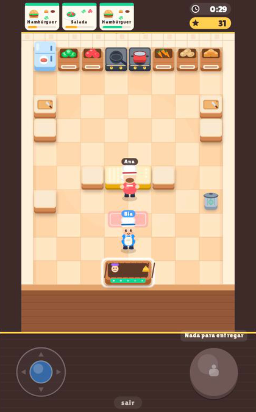
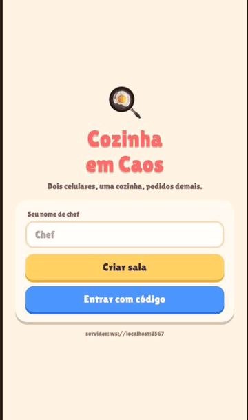
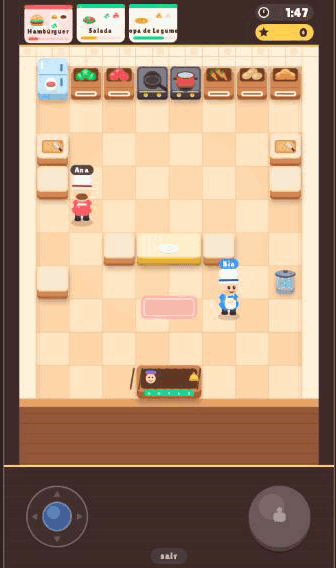

<p align="center">
  
</p>

<h1 align="center">🍳 Cozinha em Caos</h1>

<p align="center">
  <strong>Dois celulares. Uma cozinha. Pedidos demais.</strong><br>
  Um jogo cooperativo estilo <em>Overcooked</em> para jogar com um amigo, cada um no seu telefone.
</p>

<p align="center">
  <a href="https://github.com/henriquerochars/cozinha-em-caos/actions/workflows/ci.yml"></a>
  <a href="LICENSE"></a>
  
  
  
</p>

<p align="center">
  
  &nbsp;&nbsp;
  
</p>

<p align="center"><sub>GIFs gravados na versão web, com as duas chefs controladas por script. É o jogo de verdade rodando, não um mockup.</sub></p>

---

## Como funciona

1. Um jogador **cria a sala** e recebe um código de 6 letras. O outro **entra com o código**.
2. Os dois apertam **"Estou pronto!"**, rola uma contagem regressiva e a cozinha abre por 3 minutos.
3. Os pedidos aparecem no topo. Vocês pegam ingredientes nas caixas, **cortam** nas tábuas, **cozinham** nos fogões, **montam** o prato na ilha central e **entregam** na janela.
4. Entregar rápido dá bônus. Deixar o cliente ir embora tira pontos. No fim, de 0 a 3 estrelas.

**Receitas de hoje:** Salada (alface + tomate picados), Hambúrguer (pão + carne grelhada + alface) e Sopa de Legumes (cenoura + batata na panela).

### Controles

| Celular | Navegador (para testar) |
| --- | --- |
| Joystick flutuante: encoste em qualquer lugar da faixa inferior e arraste | `WASD` ou setas |
| Botão grande à direita: faz a ação que o jogo sugere (Pegar, Cortar, Montar, Entregar…) | `Espaço`, `Enter` ou `E` |

O botão sempre mostra o que vai acontecer. Quando nada é possível, ele explica o motivo ("Tábua ocupada", "Monte o prato primeiro").

## Rodando

Pré-requisitos: Node 20+, [pnpm](https://pnpm.io) 10 e o app [Expo Go](https://expo.dev/go) nos celulares (ou um navegador).

```bash
pnpm install
pnpm dev:server    # servidor em ws://localhost:2567 (imprime também o IP da rede Wi-Fi)
pnpm dev:mobile    # Expo: escaneie o QR nos dois celulares, ou aperte "w" para abrir no navegador
```

Celulares na mesma rede Wi-Fi do computador descobrem o servidor sozinhos (o app usa o IP que o Expo expõe). Em outra rede, ou em produção, defina `EXPO_PUBLIC_SERVER_URL` em `apps/mobile/.env` (veja `.env.example`) ou ajuste o endereço na tela inicial do app.

Para testar sozinho no computador, abra duas abas do navegador: uma cria a sala, a outra entra com o código.

## Por dentro

```
cozinha-em-caos/
├── apps/
│   ├── server/     Colyseus 0.18 — a sala é a cozinha; o servidor é a autoridade
│   └── mobile/     Expo SDK 58 + React Native Skia — desenho, previsão local, sons e controles
└── packages/
    └── shared/     regras puras usadas pelos dois lados: mapa, receitas, movimento, ações, pontos
```

- **Servidor autoritativo.** Movimento, colisões, cortes, cozimento, pedidos e pontuação acontecem no servidor a 20 Hz. O cliente só manda a direção do joystick e "apertei o botão".
- **Previsão local + interpolação.** O seu chef responde na hora usando exatamente o mesmo código de movimento do servidor (está em `packages/shared`), e é reconciliado quando a posição oficial chega. O chef do parceiro é interpolado suavemente.
- **Regras compartilhadas.** A função que decide "o que posso fazer nesta bancada com isso na mão" é a mesma no servidor (validação) e no cliente (texto do botão). Impossível divergirem.
- **Tudo é vetor.** Cozinha, chefs, ingredientes, pratos, partículas e HUD são desenhados proceduralmente com Skia em um único `Picture` por quadro, atualizado por *shared value*. Nada de sprites nem re-render do React durante a partida.
- **Sons gerados por código.** Os efeitos em `apps/mobile/assets/sounds` saem de `scripts/gen-sounds.mjs`, sem assets externos.
- **Reconexão.** Se um celular cair, a partida pausa e espera até 45 s pelo jogador voltar.

## Qualidade

```bash
pnpm typecheck   # TypeScript estrito nos três pacotes
pnpm test        # regras compartilhadas, simulação e um teste de integração real cliente ↔ servidor
```

O teste de integração sobe o servidor de verdade, conecta dois clientes pelo SDK, cria e entra na sala pelo código e completa um pedido de salada só com mensagens de rede.

## Ideias para o futuro

- Mais receitas e um segundo mapa
- Fases com dificuldade crescente e placar entre amigos
- Tutorial interativo na primeira partida
- Partidas com 3 ou 4 chefs

Sugestões, bugs e PRs são bem-vindos. Abra uma issue ou mande um PR.

## Licença

[MIT](LICENSE) © Henrique Rocha Serrano
